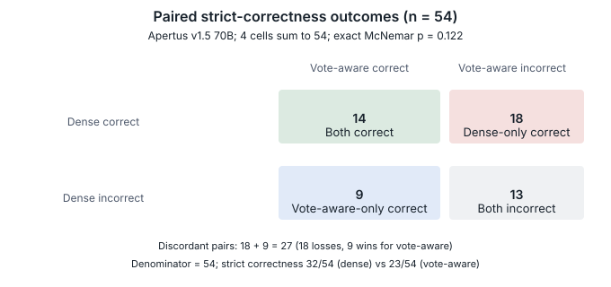
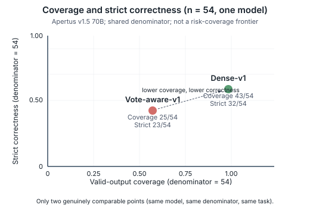
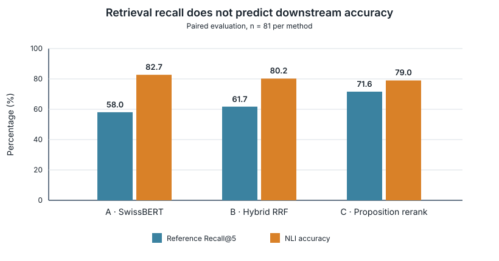

# Technical report — VoteLens: The Courage to Be Wrong

<!-- Working title only: the 14 October team meeting did NOT finalise the team or
project name, and no confirmed decision is recorded in this repository. Retained
teammate scratch note (for human review, delete or replace before submission):
"something more academic etc — a purpose vote check / claim checking with purpose".
HUMAN DECISION REQUIRED. -->

**Subtitle:** Evidence Traceability and Failure Anatomy in Multilingual Document-Grounded NLI over Swiss Voting Booklets

- **Track:** Track 2A — OST: Multilingual Document-Grounded NLI over Swiss Official Voting Booklets
- **Event:** HackApertus (online)
- **Team:** *not finalised — placeholder pending team confirmation (three members; no member has confirmed a public team name or member list).*
- **Demo:** [The Courage to Be Wrong — interactive research demo](docs/experience/courage-to-be-wrong/README.md), located at `docs/experience/courage-to-be-wrong/` (open `index.html` in a browser). This is a **recorded-results interactive research demonstration**, not a live Apertus inference service: no model, no server, no network. No public hosting URL exists.

*Status: submission draft, 14 October 2026. All results in this report are single-run exploratory analyses on **exposed development data**, not held-out benchmarks.*

## 1. Summary

**The problem and the approach.** Swiss direct democracy asks citizens to adjudicate complex referenda — often several questions on one voting day — from official booklets that are multilingual (DE/FR/IT), structurally repetitive, and place supporting and opposing arguments in the same document. Martin et al. (2024) identify this setting as a high-stakes domain for LLM-based retrieval-augmented generation and frame the civic risk as erosion of the shared epistemic ground on which democratic deliberation depends. VoteLens is a document-grounded NLI diagnostic built for that setting: given a booklet (or a supplied reference) and a claim, it retrieves up to five within-booklet passages, asks an Apertus v1.5 model to judge the claim as entailment, neutral or contradiction, and validates the model's JSON answer — vote identity, citation occurrence, output schema — before returning it.

**Headline finding — stricter output validation can create a substantial coverage cost.** In the 54-case paired development comparison (Apertus v1.5 70B via CSCS), the strict `vote-aware-v1` candidate achieved slightly *higher* raw-label accuracy (41/54 vs 40/54 for the `dense-v1` control) yet dramatically *lower* valid-output coverage (25/54 vs 43/54) and lower overall strict correctness (23/54 = 42.6% vs 32/54 = 59.3%). Of the candidate's 29 rejected outputs, **18 had a correct raw NLI label**. Among the 18 gold-neutral cases, **none became a valid accepted output**: 12 returned a correctly neutral raw label whose `vote_status` was `null` (rejected by the identity gate), and six returned contradiction. Conditional accuracy among accepted outputs was 23/25 = 92%, while overall strict correctness was 23/54 = 42.6%. The paired exact McNemar test gives p = 0.122078: this is an exploratory comparison, not a statistically established deterioration. The central message is therefore about evaluation methodology as much as about the system: **an apparently reliable system can look better when evaluated only on accepted answers, while rejecting many otherwise correct ones** — 92% "accuracy" on the 25 accepted outputs hides 18 correct labels destroyed by the output contract.

This comparison is **not** a controlled single-factor experiment: retrieval query, prompt, schema, identity gate and citation mechanism changed together. In particular, the immediate rejection mechanism is the identity gate, but no claim follows that the identity gate alone caused every observed error. The comparison used the 70B model, **not** the official 8B submission target; results do not transfer to 8B without testing.

**Supporting findings (secondary, not equal in weight to the headline).**

- **A · Evidence scope.** Focusing on five within-booklet passages beat full-booklet prompting (accuracy 0.802 vs 0.519 on 81 paired development cases) at 96.3% fewer input tokens.
- **B · Retrieval ablation.** On a separate frozen 81-case development sample, higher Recall@5 did *not* imply higher downstream NLI accuracy: proposition reranking raised R@5 from 0.580 to 0.716 while accuracy fell from 0.827 to 0.790.
- **C · Evidence placement.** A 15-case diagnostic found three label regressions when the same decisive evidence was moved behind distractors at identical input-token counts — an exploratory observation that suggests possible positional sensitivity, without causal proof.

## 2. Architecture

**Production data flow (submission path, `src/booklet_app.py`).**

1. **Input.** Two official request shapes: *Beginner* supplies a reference passage and claim directly; *Advanced* supplies a booklet PDF path, a vote name and a claim. Booklet language is detected as DE/FR/IT; the claim may be in any of those languages. Gold references and labels never enter extraction, ranking or judgement.
2. **Extraction.** Poppler extracts text with physical page boundaries (Advanced only; no silent truncation).
3. **Retrieval.** The *supplied booklet only* is chunked into 900-character passages; Top-5 are selected by SentenceSwissBERT mean-pooled cosine similarity (Vamvas et al., 2023; SimCSE-derived procedure per Gao et al., 2021), with query and passage adapters using the booklet language. There is no global cross-booklet search on the submission path.
4. **Apertus inference.** The judge receives the claim, retrieved evidence and speaker-attribution instructions, and must return a JSON object with a label code (0 = entailment, 1 = neutral, 2 = contradiction), cited passage IDs and source spans, and a vote-status field.
5. **Output validation.** Before rendering, the application validates vote identity, page-relative offsets, citation occurrence and schema consistency. Invalid, ungrounded or incomplete results exit non-zero — no lexical fallback, no silently defaulted neutral.

**Three separable stages.** Retrieval *selects* evidence; Apertus *judges* the claim; output validation *checks contract compliance*. A citation is "verified" only in the mechanical sense that the quoted string occurs in the supplied evidence — textual provenance, **not** semantic support. The observed failures do not decompose along stage boundaries; the diagnostic frame used in §5 assigns each failure to the earliest independently measurable layer:

- **L1 Retrieval scope** — evidence left the named vote, or the decisive proposition was displaced by the ranker.
- **L2 Semantic sufficiency** — evidence is relevant but does not *establish* the claim. *No independent annotation of this layer exists yet.*
- **L3 Speaker attribution** — the right proposition, credited to the wrong stakeholder.
- **L4 Output contract** — a correct raw label rejected by the identity/citation gate.

Two distinctions are maintained throughout: **output-validation failure ≠ reasoning failure**, and **evidence supported ≠ evidence sufficient**.

**Where each component runs.** Retrieval and validation run in a CPU-only Docker container (or natively with `python3`); the model runs at an external OpenAI-compatible endpoint (default `make run`) or in an optional managed vLLM service. Apple Silicon MLX serving is a development-only path and is never part of the submission image.

## 3. Use of Apertus

- **Official submission target:** `swiss-ai/Apertus-v1.5-8B` (inference only), addressed via the standard `LLM_NAME` / `LLM_BASE_URL` / `LLM_API_KEY` environment variables against an externally provisioned endpoint, or via the optional managed vLLM service. **NOT TESTED end-to-end with official 8B weights** — configuration is verified statically only (see §7).
- **Third-party quantised 8B MLX diagnostics:** `m1rkocasu/Apertus-v1.5-8B-text-MLX-6bit` (revision `9a3c32df`, 6-bit affine quantisation, 81,920-token context), served locally by `mlx_lm.server` on Apple Silicon. Used for the full-booklet comparison, retrieval ablation and evidence-sensitivity diagnostic. Its quantisation and serving behaviour differ from the submission target; its numbers are diagnostics, not submission evidence.
- **70B CSCS exploratory development:** `swiss-ai/Apertus-v1.5-70B` via the CSCS inference API. Used for the 54-case paired comparison (the headline result), the n=1 Advanced Docker smoke and the 27-example prompt-only pilot. Neither performance nor response patterns should be assumed to transfer to the 8B target.

**Decoding and prompts.** All experiments used temperature 0, a 512-token output allowance and strict JSON parsing; failed or invalid outputs remain in denominators. Managed and native arms pass seed 20261011; the CSCS path uses standard OpenAI-compatible fields and does not send the vLLM-specific thinking control or seed. The production prompt is `current_v1`; a 27-example prompt-only pilot on 70B found no accuracy gain from the refined prompt (23/27 both arms, 18.8% more input tokens), so no prompt change was promoted. Deterministic JSON recovery (stripping markdown fences, extracting the first JSON object) is applied before the label parser — format normalisation, not semantic interpretation; unparseable outputs remain errors.

## 4. Data

- **Evaluation set.** HackApertus-provided MNLI-over-Swiss-Voting-Booklets v1.1 (1,488 items; 60-item dev split), fetched by `fetch_eval_data.py` into git-ignored `data/eval/`. Twenty-four of the 60 dev rows duplicate claim/reference/label triples in the 1,428-row complement (25 share claims, 46 share references); the complement is **not** held out. All development samples used in §5 are drawn from this historically exposed corpus and are exploratory evidence, not unbiased generalisation estimates.
- **Booklet PDF corpus.** Sixty booklet PDFs discovered via the eval set's `booklet_url` field, text-extracted into a 16,618-passage corpus (`data/booklets/corpus.json`, git-ignored, rebuilt by `make fetch-booklets`). 1,470/1,488 (98.8%) gold evidence strings locate inside it; the 18 that do not are mostly FR/IT reference strings that match neither verbatim nor by shingle coverage — the two spot-checked are not verbatim booklet text at all, probably labelling artefacts (unresolved).
- **Exposure.** Every case used in §5 was previously inspected during development, and the 15-case sensitivity diagnostic was selected *post hoc* after observing failures, with curated evidence designed with knowledge of claims and gold labels.
- **Licensing constraints.** No full booklet text, PDF or long verbatim source block is redistributed in `docs/` or in the demo; short per-case strings in the demo are model outputs or <25-word quotations, marked and provenance-stamped there. Third-party code and source-data licences (Swiss federation booklet texts, Hugging Face model cards, SentenceSwissBERT) require final review before publication — no redistribution permission is claimed here beyond what has been verified.
- **Personal data.** None: the pipeline processes official publications and synthetic or published evaluation claims; no human-subject data or personal information is stored.

## 5. Evaluation

**Metrics and denominators.** Four distinct measures appear below: *raw-label accuracy* (the model's recognised label matches gold, whether or not the output contract would accept the response); *strict correctness* (correct label AND accepted official response); *valid-output coverage* (fraction of cases satisfying the full output contract; rejects and endpoint failures count against coverage); *citation verified* (mechanical source-string occurrence, not semantic support). Failed or unparseable outputs are recorded as errors (`pred = None`), never defaulted to neutral. The 15-case sensitivity panel contains only entailment and contradiction gold labels, so its macro-F1 averages over two classes and is not comparable with three-class figures elsewhere.

### 5.1 Headline: the 54-case paired coverage result

54 paired cases on CSCS Apertus v1.5 70B (two examples per language-pair × gold-label cell, alternating AB/BA order, 108 accounted calls). This is a complete-system comparison — retrieval query, prompt, schema, identity gate and citation mechanism changed together — so it cannot isolate the effect of vote awareness.

| Metric | `dense-v1` | `vote-aware-v1` |
|---|---:|---:|
| Raw label accuracy | 40/54 (0.741) | 41/54 (0.759) |
| Strict accuracy | 32/54 (0.593) | 23/54 (0.426) |
| Valid-output coverage | 43/54 (0.796) | 25/54 (0.463) |
| Rejections | 11 | 29 |
| Macro-F1 (invalid = error) | 0.652 | 0.491 |

The candidate's 29 rejections: 14 `vote_unrecognised`, 15 `invalid_vote_status`. All 29 still contained a parseable raw NLI label; 18 matched gold. Conditional accuracy among the candidate's 25 accepted outputs was 23/25 = 92% — against 23/54 = 42.6% strict correctness over all cases (the control's conditional figure is 32/43 = 74.4%). Reporting only the conditional figure would create a misleading impression of reliability. On strict correctness: 18 dense-only correct, 9 candidate-only correct, 14 both correct, 13 both incorrect; paired exact McNemar p = 0.122078 (not significant; does not establish equivalence or absence of difference either).

*Where the rejections happened is not why the answers went wrong.* In row 728, all five retrieved passages concerned the Climate and Innovation Act for a COVID-19 claim — a retrieval-scope failure alongside an identity failure. In row 1115, the evidence explicitly named the requested initiative and the raw label was correct, yet the gate rejected the output. In row 964, several passages identified the cash initiative, yet the model declared it unrecognised and produced an incorrect label. These three cases are not one mechanism, so the identity gate is not claimed to have caused every error.

*This is not selective classification* (Geifman and El-Yaniv, 2017): the gate optimises no coverage–risk frontier and offers no risk guarantee; it uniformly destroyed coverage. The methodological caution of Hutiri et al. (2024) applies — in their unrelated domain of speaker-verification bias they show empirically that base-metric selection, ratio-versus-difference comparison and aggregation can produce contradictory conclusions from identical data. We therefore report all denominators explicitly and quote no single figure as *the* system accuracy.

**Figure 1.** Paired strict-correctness outcomes for the 54-case vote-aware comparison (Apertus v1.5 70B). Four cells: both correct 14, dense-only correct 18, vote-aware-only correct 9, both incorrect 13. Exact McNemar p = 0.122.

**Figure 2.** Valid-output coverage versus strict correctness for the 54-case paired comparison (one model, one denominator; shared axis transform). Two genuinely comparable points — **not** a risk-coverage frontier: the gate was not calibrated and no direction of improvement is implied. The interactive version with additional context is at `docs/experience/courage-to-be-wrong/`.

### 5.2 Supporting A and B: evidence scope and the retrieval ablation

Full-booklet vs Top-5 retrieval, 81 paired development cases on the 8B MLX diagnostic model: accuracy 0.519 → 0.802 at 96.3% fewer input tokens (one retrieved run hit the output limit; 80/81 completed). This motivates the retrieved-evidence architecture; it is a development design decision, not a benchmark result.

Retrieval ablation, three arms on a frozen 81-case development sample (27 per NLI label, 9 per DE/FR/IT combination), all 243 calls completed:

| Method | Accuracy | Macro-F1 | R@5 | Citation verified | Mean tokens |
|---|---:|---:|---:|---:|---:|
| A · dense SentenceSwissBERT | 0.827 | 0.824 | 0.580 | 51.9% | 1,215 |
| B · hybrid RRF | 0.802 | 0.797 | 0.617 | 49.4% | 1,326 |
| C · proposition reranking | 0.790 | 0.784 | 0.716 | 44.4% | 1,314 |

Arm C increased R@5 by 11/81 cases yet produced three fewer correct labels: optimising a lexical reference-recall proxy did not improve downstream NLI. The original RRF work evaluated retrieval-ranking effectiveness (Cormack et al., 2009); its gains do not imply improvements in our separate downstream objective. Paired sign tests (A→B: 3 wins/5 losses; A→C: 4/7; 70–73 ties) condition on 8–11 discordant pairs and are underpowered; none supports a significant difference.

**Figure 3.** Reference Recall@5 versus NLI accuracy (81-case ablation). Source: `data/experiments/retrieval-ablation-v1/summary.json` (git-ignored).

### 5.3 Supporting C: evidence placement (exploratory)

15 post-hoc selected cases (8 entailment, 7 contradiction; no neutral gold), 60 calls, 8B MLX. Conditions: A original Top-5; B manually constructed sufficient evidence (case-informed upper bound); C = B + two reviewed non-decisive distractors; D = identical to C with the B block moved *behind* distractors (identical input-token counts).

| Condition | Correct | Accuracy | Macro-F1 | Input tokens |
|---|---:|---:|---:|---:|
| A · original Top-5 | 8/15 | 0.533 | 0.593 | 18,837 |
| B · minimal sufficient | 15/15 | 1.000 | 1.000 | 5,784 |
| C · B + distractors | 14/15 | 0.933 | 0.933 | 9,570 |
| D · distractors + B | 11/15 | 0.733 | 0.786 | 9,570 |

C→D produced three regressions (rows 1026, 1344, 189) with identical passage multisets and token counts — suggestive of the positional sensitivity studied by Liu et al. (2024), but 15 post-hoc cases in a single run cannot establish that mechanism. Row 1344 shows an explanation–label inconsistency (the output states "4%, not 10%" yet labels neutral against a contradiction gold), flagged following Turpin et al. (2023); B is an upper bound, not a retrieval method, and only 11/15 B citations passed the strict source-occurrence check.

## 6. Limitations

- **Exposure and selection.** All measurements are single runs on exposed development data; the 54- and 15-case samples were drawn after failures were observed; curated evidence was designed with knowledge of claims and gold labels. None of the samples supports unbiased generalisation estimates.
- **Wrong target model.** The headline comparison uses 70B, not the 8B submission target. Nothing here validates 8B behaviour.
- **Confounding.** The paired comparison changes retrieval, prompt, schema, identity gate and citation mechanism simultaneously; no factor is separable, and no causal attribution (including to the identity gate) follows.
- **Metric non-comparability.** Denominators and x-axis metrics differ across panels (completion coverage, citation rate, valid-output coverage); Figure 2 deliberately shows only the two points that share one denominator. The McNemar result is underpowered at n = 54.
- **No human semantic adjudication.** Due to the limited duration of the hackathon, independent human semantic adjudication was not undertaken. A blind annotation protocol (BlindAdjudicationProbe) is specified in the long-form technical reference (`docs/TECHNICAL_REPORT_LONG.md` §9.1, item 4) and a review-ready export format exists, but no functioning blind export interface is operational, no human annotations exist, and no inter-annotator agreement figures exist. Semantic evidence sufficiency (L2) remains independently unverified; error attributions are exploratory post-hoc analyses, not validated classifications.
- **AI-generated annotation is not ground truth.** A first exploratory annotation pass was AI-generated (Qwen-family assistant) — a different model family from the Apertus predictors, but **not independent ground truth**.
- **Deployment gaps.** Official 8B inference is NOT TESTED; the managed vLLM path has not passed a real Docker smoke; Windows/Linux execution and cold builds are unverified. Citation boundaries remain imperfect (the n=1 CSCS smoke citation starts mid-word).
- **Single machine, no variance control.** All numbers come from one machine (Apple MPS/float32 and the CSCS endpoint), single runs, no seed or variance control.

Three open research questions organise future attribution work (not established findings): **RQ1** — can a model distinguish uncertainty about a referendum's identity from insufficient evidence for a claim? **RQ2** — does independent vote grounding reduce invalid outputs without sacrificing evidence provenance? **RQ3** — how much observed failure is attributable to retrieval scope, NLI reasoning and output-contract compliance respectively?

## 7. Reproducibility

| Layer | Reproducibility status |
|---|---|
| Clean-checkout unit tests | `make test` (from `track_2a/`, portable, no model/data/network needed): judge/parser/label checks, gate-contract tests, py_compile. Data-dependent tests skip transparently. |
| Compact evidence records | `docs/evidence/` supports SHA-256 byte-identity checks; `docs/experience/courage-to-be-wrong/courage_data.py` recomputes ledger figures and exits non-zero on mismatch **when local raw records exist** (byte identity ≠ semantic verification). |
| Missing raw records | `data/experiments/` and `data/eval/` are git-ignored and not distributed; `fetch_eval_data.py` downloads the dataset only, not model predictions. In a clean checkout the demo shows static `facts.json` values and its guard reports NOT RE-VERIFIED IN THIS BUILD. |
| 70B paired development | Requires a CSCS API key; not reproducible offline. |
| MLX 8B diagnostics | Requires Apple Silicon + the cached third-party 6-bit conversion; not the submission target. |
| Official 8B submission | Configured but **untested** end-to-end (`make run` default path against a provisioned v1.5 endpoint). |

Reproduction starts with `docs/RUNNING.md`; the demo README documents local opening and re-verification. Development evidence was produced on branch `feature/votelens-research-positioning` (base commit `f424b36`) on Apple Silicon macOS; see §6 for the absence of variance control.

## 8. Next steps

All items below are **designed, not executed** (details in `docs/TECHNICAL_REPORT_LONG.md` §9.1): (1) oracle-evidence control; (2) evidence-order ablation with repeated controls to test the §5.3 placement observation; (3) `StanceAttributionChallenge` for L3 speaker attribution; (4) `BlindAdjudicationProbe` for independent human semantic adjudication. Before promoting any retrieval or validation policy: replay the 29 rejected records offline with per-case identity/sufficiency/citation adjudication independent of the generating model — a deterministic replay cannot establish how the model would answer a prompt it never received. Beyond the research line: one clean-checkout `make run` with official `swiss-ai/Apertus-v1.5-8B` weights on an NVIDIA Docker host, and a Windows/Linux portability matrix, are the minimum steps to move the deployment claims beyond NOT TESTED.

## AI Assistance Declaration

Generative AI was used **substantially** in this project: Qwen-based coding agents with OpenCode; ChatGPT for research planning, interpretation and drafting assistance; and Codex for independent cross-model repository auditing and review. Functions included code generation and modification, debugging and test generation, experimental planning, data-analysis assistance, literature discovery, technical report drafting, repository auditing and scientific claim checking. The team directed this work and remains responsible for all submitted content. Automated tests and recorded results were used to check applicable claims. **Cross-model AI auditing is not independent human verification, and no independent human semantic adjudication was performed** (see §6); the first-pass case annotations are AI-generated and are not ground truth. A separate UZH ECTS declaration is a different document and does not replace this one.

## License

Report text: Creative Commons Attribution 4.0 (CC-BY-4.0), following the official HackApertus template ("All HackApertus projects are open-sourced"). Repository code and third-party source-data licensing are under separate final review (§4); no permissions beyond those verified are claimed.

## References

### Scholarly and technical sources

1. Williams, A., Nangia, N., and Bowman, S. R. (2018). *A Broad-Coverage Challenge Corpus for Sentence Understanding through Inference*. NAACL-HLT, 1112–1122. https://aclanthology.org/N18-1101/
2. Thorne, J., Vlachos, A., Christodoulopoulos, C., and Mittal, A. (2018). *FEVER: a Large-scale Dataset for Fact Extraction and VERification*. NAACL-HLT, 809–819. https://aclanthology.org/N18-1074/
3. Lewis, P., et al. (2020). *Retrieval-Augmented Generation for Knowledge-Intensive NLP Tasks*. NeurIPS 33. https://proceedings.neurips.cc/paper/2020/hash/6b493230205f780e1bc26945df7481e5-Abstract.html
4. Vamvas, J., Graën, J., and Sennrich, R. (2023). *SwissBERT: The Multilingual Language Model for Switzerland*. SwissText, 54–69. https://aclanthology.org/2023.swisstext-1.6/
5. Gao, T., Yao, X., and Chen, D. (2021). *SimCSE: Simple Contrastive Learning of Sentence Embeddings*. EMNLP, 6894–6910. https://aclanthology.org/2021.emnlp-main.552/
6. Reimers, N., and Gurevych, I. (2019). *Sentence-BERT: Sentence Embeddings using Siamese BERT-Networks*. EMNLP-IJCNLP, 3982–3992. https://aclanthology.org/D19-1410/
7. Robertson, S., and Zaragoza, H. (2009). *The Probabilistic Relevance Framework: BM25 and Beyond*. Foundations and Trends in Information Retrieval, 4(1–2), 1–174. https://doi.org/10.1561/1500000019
8. Cormack, G. V., Clarke, C. L. A., and Büttcher, S. (2009). *Reciprocal Rank Fusion Outperforms Condorcet and Individual Rank Learning Methods*. SIGIR, 758–759. https://doi.org/10.1145/1571941.1572114
9. Liu, N. F., Lin, K., Hewitt, J., Paranjape, A., Bevilacqua, M., Petroni, F., and Liang, P. (2024). *Lost in the Middle: How Language Models Use Long Contexts*. Transactions of the ACL, 12, 157–173. https://aclanthology.org/2024.tacl-1.9/
10. Turpin, M., Michael, J., Perez, E., and Bowman, S. R. (2023). *Language Models Don't Always Say What They Think: Unfaithful Explanations in Chain-of-Thought Prompting*. NeurIPS 36. https://papers.neurips.cc/paper_files/paper/2023/hash/ed3fea9033a80fea1376299fa7863f4a-Abstract-Conference.html
11. Geifman, Y., and El-Yaniv, R. (2017). *Selective Classification for Deep Neural Networks*. NeurIPS 30. https://papers.neurips.cc/paper_files/paper/2017/hash/4a8423d5e91fda00bb7e46540e2b0cf1-Abstract.html
12. Dietterich, T. G. (1998). *Approximate Statistical Tests for Comparing Supervised Classification Learning Algorithms*. Neural Computation, 10(7), 1895–1923. https://doi.org/10.1162/089976698300017197
13. Martin, A., Witschel, H. F., Mandl, M., and Stockhecke, M. (2024). *Semantic Verification in Large Language Model-based Retrieval Augmented Generation*. Proceedings of the AAAI Symposium Series, 3(1), 188–192. https://doi.org/10.1609/aaaiss.v3i1.31199
14. Hutiri, W., Patel, T., Ding, A. Y., and Scharenborg, O. (2024). *As Biased as You Measure: Methodological Pitfalls of Bias Evaluations in Speaker Verification Research*. Interspeech 2024, 4268–4272. https://doi.org/10.21437/Interspeech.2024-1158
15. Silva, V., Freitas, A., and Handschuh, S. (2018). *Building a Knowledge Graph from Natural Language Definitions for Interpretable Text Entailment Recognition*. LREC 2018 (no DOI assigned; verified via ACL Anthology). https://aclanthology.org/L18-1542/

*Positioning note.* Martin et al. (2024) motivate semantic verification of LLM-RAG outputs in Swiss direct democracy; Silva et al. (2018) make entailment relationships auditable through a knowledge graph built from dictionary definitions. VoteLens does **not** implement either architecture: these works motivate and contextualise the questions studied here, they do not establish our findings. Our Evidence Passport shares Silva et al.'s inspectability goal but remains a provenance-oriented diagnostic representation; the retrieve-then-judge structure is established work (Lewis et al., 2020; Thorne et al., 2018), and our contribution is the failure anatomy at the evidence-to-label interface, not the architecture.

### Model cards and project records

16. Grosjean, J. *SentenceSwissBERT* (`jgrosjean-mathesis/sentence-swissbert`), model card. https://huggingface.co/jgrosjean-mathesis/sentence-swissbert
17. Swiss AI Initiative. *Apertus v1.5 8B*, model card. https://huggingface.co/swiss-ai/Apertus-v1.5-8B
18. Swiss AI Initiative. *Apertus v1.5 70B*, model card. https://huggingface.co/swiss-ai/Apertus-v1.5-70B
19. [Official HackApertus project template](https://github.com/HackApertus/project-template).
20. [OST Track 2A challenge page](https://hackapertus.notion.site/track-2a-ost).
21. Internal experimental provenance indexed in [docs/evidence/README.md](docs/evidence/README.md). Full technical reference: [docs/TECHNICAL_REPORT_LONG.md](docs/TECHNICAL_REPORT_LONG.md). Interactive diagnostic: [docs/experience/courage-to-be-wrong/](docs/experience/courage-to-be-wrong/README.md).