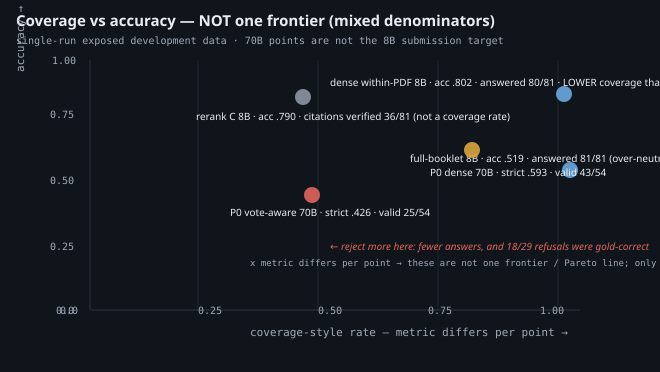

# VoteLens: The Courage to Be Wrong

**Subtitle:** Evidence Traceability and Failure Anatomy in Multilingual Document-Grounded NLI over Swiss Voting Booklets

**Track:** 2A, OST · **Status:** submission draft, 14 October 2026.

## Abstract

We present VOTELENS, a diagnostic system for document-grounded natural-language inference over official Swiss voting booklets. Given a booklet and a claim, the system retrieves page-grounded evidence and classifies entailment, neutral or contradiction using Apertus v1.5. Three observations drive this report; all are single-run analyses on *exposed development data*, not held-out benchmarks.

**(1) Retrieval scope.** Focusing on five within-booklet passages achieved accuracy 0.827 and macro-F1 0.824 at 96.3% fewer input tokens than full-booklet prompting. However, optimising a lexical reference-recall proxy did *not* improve downstream NLI: proposition reranking raised Recall@5 from 0.580 to 0.716 while accuracy fell from 0.827 to 0.790.

**(2) Coverage ≠ correctness.** A strict `vote-aware-v1` candidate achieved slightly higher raw-label accuracy (41/54 vs 40/54) yet dramatically lower valid-output coverage (25/54 vs 43/54). Of its 29 rejections, 18 were gold-correct. It rejected every gold-neutral case. Higher conditional accuracy among accepted answers does not imply higher overall strict correctness.

**(3) Placement observation.** In a 15-case diagnostic, moving the same decisive evidence behind distractors — identical input-token counts — produced three label regressions. These are single-run observations motivating a controlled ordering experiment; they do not establish a positional cause.

All three are exploratory development evidence. The 54-case comparison uses Apertus v1.5 70B, not the 8B submission target. No causal attribution of any single error follows from these data.

## 1. Introduction

Swiss direct democracy places exceptional demands on evidence reliability. Citizens must adjudicate complex referenda — often multiple questions on one voting day — using official booklets that are multilingual (DE/FR/IT), structurally repetitive, and frequently place supporting and opposing arguments in the same document. Martin et al. (2024) identify precisely this setting as a high-stakes domain for LLM-based retrieval-augmented generation: the risk is not merely factual inaccuracy but the *erosion of shared epistemic ground* upon which democratic deliberation depends. Their position paper motivates semantic verification frameworks that validate the factual content of LLM-generated summaries before they reach voters, proposing knowledge-graph-assisted cross-checking as a possible architecture.

VOTELENS addresses a narrower but adjacent question: given that a judge model *has* produced a label and a cited passage, can we trace whether the cited evidence textually occurs in the supplied booklet (mechanical provenance), and what failure modes arise at the interface between retrieval and judgement? We do not implement the knowledge-graph verification layer of Martin et al. (2024); our development experiments expose a concrete gap between output-contract validation (citation string matching) and semantic evidence sufficiency (whether a passage *establishes* a claim), which their framework would need to resolve before deployment.

Because booklets are per-language editions of one vote day, the case analyses in §3 suggest distinct proposal-scope and stakeholder-attribution failure modes rather than simple topic-matching errors: the system may find topically related material from a *different* proposal, or correctly extract the right proposition but credit it to the wrong institutional voice. These are post-hoc attributions from paired error inspection, not statistical clustering.

The submission CLI accepts a specified booklet and claim, returns entailment/neutral/contradiction with page-grounded citations. Poppler extracts physical pages; retrieval chunks the supplied booklet and retrieves Top-5 passages using SentenceSwissBERT mean-pooled cosine similarity (Vamvas et al., 2023; SimCSE-derived contrastive procedure per Gao et al., 2021). Both query and passage adapters use the booklet language. The system checks that quoted citations occur in the supplied evidence (a mechanical provenance check, *not* a semantic-support judgment). Gold references and labels never enter extraction, ranking or judgement.

Three open research questions organise the attribution analysis:

- **RQ1.** Can a model distinguish uncertainty about a referendum's identity from insufficient evidence for a claim?
- **RQ2.** Does independent vote grounding reduce invalid outputs without sacrificing evidence provenance?
- **RQ3.** How much of the observed failure is attributable to retrieval scope, NLI reasoning, and output-contract compliance?

These are questions for future controlled tests, not established causal findings from the single runs reported here.

## 2. Method

### 2.1 Pipeline

The application retrieves five 900-character passages from the specified booklet. The judge receives the claim, retrieved evidence and speaker-attribution instructions, and must output a JSON object with a label code (0 = entailment, 1 = neutral, 2 = contradiction), cited passage IDs and source spans. The application validates vote identity, page-relative offsets and citation occurrence before rendering the official response. A citation is *verified* only against supplied evidence; verification establishes textual provenance, not semantic support.

The submission target is `swiss-ai/Apertus-v1.5-8B` (inference). Local experiments use the third-party conversion `m1rkocasu/Apertus-v1.5-8B-text-MLX-6bit` (revision `9a3c32df`, 6-bit affine quantisation, 81,920-token context). The 54-case paired comparison uses `swiss-ai/Apertus-v1.5-70B` via CSCS; neither the measured performance nor the response patterns should be assumed to transfer to the 8B target without testing.

### 2.2 Experiment design

Five studies are reported; none constitutes an independent held-out benchmark. All data were previously inspected during development.

| Study | n | Model | Purpose |
|---|---|---|---|
| Full-booklet vs retrieval | 81 | 8B MLX | Evidence scope |
| Oracle diagnostic | 19 | 8B MLX | Judgement under gold evidence |
| Retrieval ablation (3 arms) | 81 | 8B MLX | Ranker effect on NLI |
| Evidence sensitivity (4 conditions) | 15 | 8B MLX | Placement and sufficiency |
| Vote-aware paired | 54 | 70B CSCS | Complete-system comparison |

All experiments used temperature 0, 512-token output allowance, strict JSON parsing, and failed/invalid outputs remain in denominators (never silently converted to neutral or defaulted).

### 2.3 Failure taxonomy

Failures are assigned to the earliest independently measurable stage:

- **L1 Retrieval scope** — evidence left the named vote, or the decisive proposition was displaced by the ranker.
- **L2 Semantic sufficiency** — evidence is relevant but does not *establish* the claim. *No independent annotation of this layer exists yet.*
- **L3 Speaker attribution** — the right proposition, credited to the wrong stakeholder.
- **L4 Output contract** — a correct raw label rejected by the identity/citation gate.

Two distinctions maintained throughout: **output-validation failure ≠ reasoning failure**, and **evidence supported ≠ evidence sufficient**.

## 3. Results

### 3.1 Retrieval ablation

Three arms compared on 81 frozen development cases (27 per NLI label, 9 per DE/FR/IT language-pair combination). Method A: dense SentenceSwissBERT. B: dense + BM25 with reciprocal rank fusion (Cormack et al., 2009). C: B followed by proposition-aware reranking. All 243 calls completed without errors.

| Method | Accuracy | Macro-F1 | R@5 | Citation verified | Mean tokens |
|---|---:|---:|---:|---:|---:|
| A · dense SentenceSwissBERT | 0.827 | 0.824 | 0.580 | 51.9% | 1,215 |
| B · hybrid RRF | 0.802 | 0.797 | 0.617 | 49.4% | 1,326 |
| C · proposition reranking | 0.790 | 0.784 | 0.716 | 44.4% | 1,314 |

**Key observation:** C increased R@5 by 11/81 cases yet produced three fewer correct labels. The original RRF work evaluated retrieval ranking effectiveness (Cormack et al., 2009); its reported gains do not imply improvements in our separate downstream NLI objective.

Paired comparisons (81 cases per transition):

| Transition | Wins | Losses | Ties | Sign test |
|---|---:|---:|---:|---:|
| A→B | 3 | 5 | 73 | p=0.727 |
| A→C | 4 | 7 | 70 | p=0.549 |

The tests condition on discordant pairs only (8–11 pairs change) and are underpowered. None supports a statistically significant difference.

**Figure 1.** Reference Recall@5 versus NLI accuracy. Source: `data/experiments/retrieval-ablation-v1/summary.json`.

### 3.2 Paired vote-aware comparison (the coverage result)

54 paired cases on CSCS Apertus v1.5 70B. Two examples per language-pair × gold-label cell, alternating AB/BA order, 108 accounted calls. This is a complete-system comparison (retrieval query, prompt, schema, identity gate and citation mechanism changed together); it cannot isolate the effect of vote awareness.

| Metric | `dense-v1` | `vote-aware-v1` |
|---|---:|---:|
| Raw label accuracy | 40/54 (0.741) | 41/54 (0.759) |
| Strict accuracy | 32/54 (0.593) | 23/54 (0.426) |
| Valid-output coverage | 43/54 (0.796) | 25/54 (0.463) |
| Rejections | 11 | 29 |
| Macro-F1 (invalid = error) | 0.652 | 0.491 |

The candidate's 29 rejections: 14 `vote_unrecognised`, 15 `invalid_vote_status`. All 29 still contained a parseable raw NLI label; **18 matched gold**. Among the 18 gold-neutral cases, 12 returned a correctly neutral raw label; none became an accepted output — 12 returned JSON `null` for `vote_status`, the remaining six returned contradiction.

On strict correctness: 18 dense-only correct, 9 candidate-only correct, 14 both correct, 13 both incorrect. Exact McNemar p = 0.122 (not significant at 0.05; does not establish equivalence or absence of difference).

**Denominators and metric selection.** The `vote-aware-v1` candidate's accepted-output accuracy is 23/25 = 92% (conditional on passing the gate), while its strict correctness over all 54 cases is 23/54 = 42.6%. The `dense-v1` conditional accuracy is 32/43 = 74.4% (strict correct among valid outputs). Reporting only the conditional figure would create a misleading impression of system reliability. Hutiri et al. (2024) demonstrate empirically — in the unrelated domain of speaker verification bias — that base-metric selection, the choice between ratio and difference measures, and aggregation methodology can produce contradictory conclusions from identical raw data. We adopt the same caution here: no single metric should be quoted as *the* system accuracy. The paired comparison changes multiple factors simultaneously (retrieval, prompt, schema, gate), so it is not a single-factor causal experiment; the appropriate summary reports raw accuracy, strict accuracy, and valid-output coverage separately, with explicit denominators.

The immediate rejection mechanism is the identity gate. However, *where* an output was rejected (the contract gate) is distinct from *why* the answer went wrong (scope, sufficiency or attribution). In row 728, all five retrieved passages concerned the Climate and Innovation Act for a COVID-19 claim — a retrieval-scope failure alongside an identity failure. In row 1115, the evidence explicitly named the requested initiative and the raw label was correct, yet the gate rejected the output. In row 964, several passages identified the cash initiative, yet the model declared it unrecognised and produced an incorrect label. These three cases are not one mechanism.

**This is not selective classification** (Geifman and El-Yaniv, 2017): the gate does not optimise a coverage–risk frontier; it uniformly destroyed coverage without demonstrating a risk guarantee.

**Figure 2.** Paired changes in strict correctness. 54 paired cases.

**Figure 3.** Accuracy vs coverage-style rates (five non-comparable points; different models, cohorts and x-axis definitions). Only the paired pair (n=54, shared denominator, one model) is genuinely comparable. Reading axes across colours is a category error. The interactive version with per-point denominators is at `docs/experience/courage-to-be-wrong/`.

### 3.3 Evidence sensitivity diagnostic

15 post-hoc selected cases (8 entailment, 7 contradiction; no neutral gold), 60 calls, 8B MLX. Four conditions per case:

- A: original recorded retrieval top-5.
- B: manually constructed sufficient evidence (case-informed upper bound).
- C: B + two reviewed non-decisive distractors (longer input than B).
- D: identical to C, but the B block moved *behind* distractors (identical input-token counts to C).

| Condition | Correct | Accuracy | Macro-F1 | Input tokens |
|---|---:|---:|---:|---:|
| A · original Top-5 | 8/15 | 0.533 | 0.593 | 18,837 |
| B · minimal sufficient | 15/15 | 1.000 | 1.000 | 5,784 |
| C · B + distractors | 14/15 | 0.933 | 0.933 | 9,570 |
| D · distractors + B | 11/15 | 0.733 | 0.786 | 9,570 |

**C→D produced three regressions** (rows 1026, 1344, 189) with identical passage multisets and identical per-case token counts. This is related to positional sensitivity in long contexts (Liu et al., 2024), but our short selected examples cannot establish the same mechanism; single runs cannot identify a deterministic causal effect of ordering.

Row 1344 illustrates an explanation–label inconsistency: the model's output correctly states "4%, not 10%" yet labels the claim neutral (gold: contradiction). This is an output inconsistency, not a parser error; the raw JSON already contained `neutral`.

B represents a case-informed upper bound; it is not a deployable retrieval method. Only 11/15 B citations passed the strict source-occurrence check.

## 4. Positioning and related work

**Civic information infrastructure.** Martin et al. (2024) provide the closest conceptual antecedent. Their position paper motivates semantic verification of LLM-RAG outputs in Swiss direct democracy, proposes a knowledge-graph framework for cross-referencing generated claims against structured sources, and identifies the civic risk of unverified generation during referenda. VOTELENS does not implement their knowledge-graph verification; our contribution is empirical rather than architectural: we expose what happens at the *evidence-to-label* interface when provenance checking (string occurrence) is present but semantic sufficiency adjudication is absent, and show that the resulting coverage failure is invisible to any metric that counts only accepted outputs.

**Evidence-grounded NLI and retrieval.** The retrieve-then-judge pipeline structure is established (Lewis et al., 2020; Thorne et al., 2018). Our contribution is not the architecture but the failure anatomy: showing that in Swiss booklets, the interface between retrieval and judgement produces errors that cannot be attributed to either stage alone.

**Interpretable entailment and structured representations.** Silva et al. (2018) construct a knowledge graph from natural-language dictionary definitions to provide interpretable reasoning traces for textual entailment. Their representation organises semantic relationships (hypernymy, meronymy, thematic roles) to make entailment decisions auditable. Our Evidence Passport — Claim → Vote → Source → Stakeholder → Position — shares the goal of making evidence relationships inspectable, but is currently a *provenance-oriented diagnostic representation* rather than a verified knowledge graph. The system has not independently adjudicated the semantic sufficiency of those relationships; the chain records *where* a citation was found, not whether it *establishes* the claim. This gap between source occurrence and semantic support is precisely what Silva et al.'s structured representations would expose but VOTELENS does not yet resolve.

**Sentence embeddings.** SentenceSwissBERT is an adaptation of SwissBERT (Vamvas et al., 2023) using a SimCSE-derived procedure (Gao et al., 2021), related to but distinct from Sentence-BERT (Reimers and Gurevych, 2019).

**Positional sensitivity.** Our C→D comparison relates to Liu et al. (2024) but is a 15-case, single-run, short-context observation, not a replication of their multi-document findings.

**Explanation faithfulness.** We flag explanation–label inconsistencies (rows 1344, 964) following Turpin et al. (2023). We do not assume that model-generated explanations faithfully describe the internal decision process.

**Selective classification.** The coverage collapse is not a calibrated reject-option system (Geifman and El-Yaniv, 2017). No risk–coverage curve was computed; no abstention threshold was calibrated.

**Methodological note on metric selection.** The paired comparison in §3.2 illustrates the methodological point emphasised by Hutiri et al. (2024): system-level conclusions are sensitive to the base metric, the choice between ratio-based and difference-based comparison, and the aggregation level. Our 92% conditional accuracy on 25 accepted outputs versus 42.6% strict accuracy on 54 total cases would support contradictory narratives about system reliability. We therefore report all denominators explicitly and resist collapsing them into a single summary figure.

**Paired statistical comparisons** use exact McNemar/sign tests following the recommendation of Dietterich (1998) for paired classifier comparisons.

## 5. Limitations and reproducibility

All measurements are single runs on exposed development data. Denominators differ across panels; x-axis metrics differ (completion coverage, citation rate, valid-output coverage); the five data points in Figure 3 are not one frontier.

The 54-case comparison uses 70B, not the 8B submission target. Retrieval query, prompt, schema, identity gate and citation mechanism changed simultaneously — no factor can be attributed independently.

The 15-case evidence diagnostic was selected post-hoc after observing failures. Curated evidence was designed with knowledge of claims and gold labels.

**Human annotation.** Due to the limited duration of the hackathon, independent human semantic adjudication was not undertaken. A blind annotation protocol (BlindAdjudicationProbe) is specified in the long-form technical reference (§9.1, item 4) and a review-ready export format exists; however, no functioning blind export interface is currently operational, no human annotations have been collected, and no inter-annotator agreement figures exist. Semantic evidence sufficiency (L2 in the taxonomy) remains independently unverified. Error attributions remain exploratory post-hoc analyses, not validated classifications.

A first exploratory annotation pass was AI-generated (Qwen-family assistant), is a *different model family* from the Apertus predictors but is **not independent ground truth**.

Dataset provenance: HackApertus-provided MNLI-over-Swiss-Voting-Booklets v1.1 under `data/eval/`. Twenty-four of 60 dev rows duplicate claim/reference/label triples in the 1,428-row complement. The 81-case and 54-case samples are drawn from this historically exposed corpus. These are exploratory development evidence, not unbiased generalisation estimates.

### Reproducibility Passport

| Layer | What it covers | Reproducibility status |
|---|---|---|
| 70B paired development evidence | 54-case paired comparison, CSCS API | Requires CSCS API key; not reproducible offline |
| Third-party quantised MLX 8B diagnostics | Retrieval ablation, evidence sensitivity, oracle | Requires Apple Silicon + cached MLX model; not the submission target |
| Official 8B submission runtime | `swiss-ai/Apertus-v1.5-8B` via vLLM or managed Docker | Configured but **untested** end-to-end |
| Publicly tracked summaries | `data/experiments/*/summary.json` | Git-tracked; recomputable via `courage_data.py` |
| Git-ignored raw results | Per-case JSON under `data/logs/`, `data/eval/` | Not distributed; regenerate with `fetch_eval_data.py` |
| Build-time verification | `make test` (offline regression checks) | Runs without model; guards label mapping, parser, pipeline contract |
| Independent reproduction limitations | All panels | Single runs; no variance control; exposed development data only |

Management of the full experiment code and raw records is described in `docs/PROJECT_STATUS.md`; the long-form technical reference is at `docs/TECHNICAL_REPORT_LONG.md`.

Reproduction starts with `docs/RUNNING.md`. The interactive diagnostic (no model, no server) is at `docs/experience/courage-to-be-wrong/`; its data-verification guard (`courage_data.py`) recomputes every displayed figure from run records and exits non-zero on disagreement.

## 6. Future work (designed, not run)

Four controlled experiments are specified in the long-form reference (Section 9.1): oracle-evidence control, evidence-order ablation with repeated controls, `StanceAttributionChallenge`, and `BlindAdjudicationProbe`. None has been executed. A deterministic replay cannot establish how the model would answer a prompt it never received.

Before promoting any new retrieval or validation policy: replay the 29 rejected records offline with per-case identity/sufficiency/citation adjudication independent of the generating model.

## 7. Conclusion

VOTELENS contributes a failure anatomy for document-grounded NLI over Swiss voting booklets. The evidence shows that (a) retrieval quality does not straightforwardly transfer to NLI quality, (b) output-contract validation can destroy coverage without improving correctness, and (c) metric selection determines whether the system appears reliable. None of these findings is a causal result; all require replication on the 8B target with independent semantic adjudication before deployment claims are warranted.

## License

Report: CC-BY-4.0. Repository code and source-data licensing require final review.

## References

### Scholarly and technical sources

1. Williams, A., Nangia, N., and Bowman, S. R. (2018). *A Broad-Coverage Challenge Corpus for Sentence Understanding through Inference*. NAACL-HLT, 1112–1122. https://aclanthology.org/N18-1101/
2. Thorne, J., Vlachos, A., Christodoulopoulos, C., and Mittal, A. (2018). *FEVER: a Large-scale Dataset for Fact Extraction and VERification*. NAACL-HLT, 809–819. https://aclanthology.org/N18-1074/
3. Lewis, P., et al. (2020). *Retrieval-Augmented Generation for Knowledge-Intensive NLP Tasks*. NeurIPS 33. https://proceedings.neurips.cc/paper/2020/hash/6b493230205f780e1bc26945df7481e5-Abstract.html
4. Vamvas, J., Graën, J., and Sennrich, R. (2023). *SwissBERT: The Multilingual Language Model for Switzerland*. SwissText, 54–69. https://aclanthology.org/2023.swisstext-1.6/
5. Gao, T., Yao, X., and Chen, D. (2021). *SimCSE: Simple Contrastive Learning of Sentence Embeddings*. EMNLP, 6894–6910. https://aclanthology.org/2021.emnlp-main.552/
6. Reimers, N., and Gurevych, I. (2019). *Sentence-BERT: Sentence Embeddings using Siamese BERT-Networks*. EMNLP-IJCNLP, 3982–3992. https://aclanthology.org/D19-1410/
7. Robertson, S., and Zaragoza, H. (2009). *The Probabilistic Relevance Framework: BM25 and Beyond*. Foundations and Trends in Information Retrieval, 4(1–2), 1–174. https://doi.org/10.1561/1500000019
8. Cormack, G. V., Clarke, C. L. A., and Büttcher, S. (2009). *Reciprocal Rank Fusion Outperforms Condorcet and Individual Rank Learning Methods*. SIGIR, 758–759. https://doi.org/10.1145/1571941.1572114
9. Liu, N. F., Lin, K., Hewitt, J., Paranjape, A., Bevilacqua, M., Petroni, F., and Liang, P. (2024). *Lost in the Middle: How Language Models Use Long Contexts*. Transactions of the ACL, 12, 157–173. https://aclanthology.org/2024.tacl-1.9/
10. Turpin, M., Michael, J., Perez, E., and Bowman, S. R. (2023). *Language Models Don't Always Say What They Think: Unfaithful Explanations in Chain-of-Thought Prompting*. NeurIPS 36. https://papers.neurips.cc/paper_files/paper/2023/hash/ed3fea9033a80fea1376299fa7863f4a-Abstract-Conference.html
11. Geifman, Y., and El-Yaniv, R. (2017). *Selective Classification for Deep Neural Networks*. NeurIPS 30. https://papers.neurips.cc/paper_files/paper/2017/hash/4a8423d5e91fda00bb7e46540e2b0cf1-Abstract.html
12. Dietterich, T. G. (1998). *Approximate Statistical Tests for Comparing Supervised Classification Learning Algorithms*. Neural Computation, 10(7), 1895–1923. https://doi.org/10.1162/089976698300017197
13. Martin, A., Witschel, H. F., Mandl, M., and Stockhecke, M. (2024). *Semantic Verification in Large Language Model-based Retrieval Augmented Generation*. Proceedings of the AAAI Symposium Series, 3(1), 188–192. https://doi.org/10.1609/aaaiss.v3i1.31199
14. Hutiri, W., Patel, T., Ding, A. Y., and Scharenborg, O. (2024). *As Biased as You Measure: Methodological Pitfalls of Bias Evaluations in Speaker Verification Research*. Interspeech 2024, 4268–4272. https://doi.org/10.21437/Interspeech.2024-1158
15. Silva, V., Freitas, A., and Handschuh, S. (2018). *Building a Knowledge Graph from Natural Language Definitions for Interpretable Text Entailment Recognition*. LREC 2018. https://aclanthology.org/L18-1542/

### Model cards and experimental records

16. Grosjean, J. *SentenceSwissBERT* (`jgrosjean-mathesis/sentence-swissbert`), model card. https://huggingface.co/jgrosjean-mathesis/sentence-swissbert
17. Swiss AI Initiative. *Apertus v1.5 8B*, model card. https://huggingface.co/swiss-ai/Apertus-v1.5-8B
18. Swiss AI Initiative. *Apertus v1.5 70B*, model card. https://huggingface.co/swiss-ai/Apertus-v1.5-70B
19. [Official HackApertus project template](https://github.com/HackApertus/project-template).
20. [OST Track 2A challenge page](https://hackapertus.notion.site/track-2a-ost).
21. Internal experimental provenance indexed in [docs/evidence/README.md](docs/evidence/README.md). Full technical reference: [docs/TECHNICAL_REPORT_LONG.md](docs/TECHNICAL_REPORT_LONG.md). Interactive diagnostic: [docs/experience/courage-to-be-wrong/](docs/experience/courage-to-be-wrong/README.md).