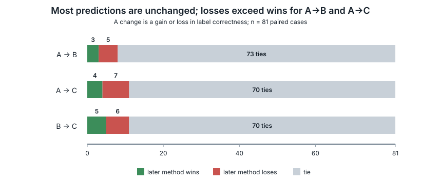
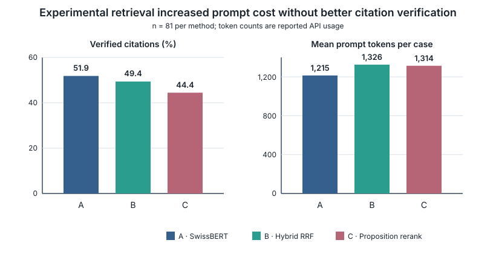

# Retrieval quality and multilingual NLI over Swiss voting booklets

**Track:** 2A, OST · **Event:** Online · **Status:** submission draft, 13
October 2026. Team names and demo link remain to be supplied. This Markdown is
not yet the final, at-most-six-page PDF.

## Abstract

We study document-grounded natural-language inference (NLI) over official Swiss
voting booklets. The application accepts a specified booklet and a claim, then
returns entailment, neutral or contradiction with page-grounded evidence. A
previous 81-case development comparison found that within-booklet retrieval
outperformed full-booklet prompting (accuracy 0.802 versus 0.519) while using
96.3% fewer input tokens. We therefore ask whether stronger retrieval further
improves downstream NLI. On a separate frozen 81-case development sample, dense
SwissBERT retrieval achieved accuracy 0.827 and macro-F1 0.824. Hybrid reciprocal
rank fusion achieved 0.802/0.797, while proposition-aware reranking achieved
0.790/0.784 despite raising lexical reference Recall@5 from 0.580 to 0.716.
Paired changes were small and non-significant: proposition reranking produced
four gains, seven losses and 70 ties against the dense baseline. Manual analysis
attributes no single cause: decisive propositions were sometimes displaced,
stakeholders or proposals were conflated, the judge sometimes misread adequate
evidence, and the lexical reference proxy missed useful alternatives. The new
experiment provides no evidence that either experimental retrieval method
improves NLI accuracy. Dense within-booklet SwissBERT retrieval remains the
performance baseline.

A subsequent 15-case post-hoc diagnostic obtained 15/15 correct labels with
manually constructed sufficient evidence, 14/15 after adding distractors and
11/15 after moving the same decisive evidence behind them. The latter contrast
preserved both evidence and input-token counts. These selected-case results
motivate further sufficiency and ordering controls; they do not establish a
generalisable accuracy improvement or a deployable retrieval method.

The submission CLI was subsequently hardened as `vote-aware-v1`. In a paired
54-case CSCS 70B development evaluation, its recoverable raw-label accuracy was
41/54 (0.7593), compared with 40/54 (0.7407) for frozen `dense-v1`, but only
23/54 candidate outputs satisfied the complete submission contract, compared
with 32/54 for the baseline. The candidate rejected every gold-neutral case.
This exploratory complete-system comparison does not demonstrate a raw NLI gain
and does not support replacing `dense-v1` as the performance baseline.

## 1. Research question and application

Swiss voting booklets are multilingual, structurally repetitive and often place
supporting and opposing arguments in the same document. Retrieval must therefore
find not only the topic but the correct proposition, number, condition and
speaker. Our research question is whether hybrid lexical–dense retrieval or
proposition-aware reranking improves classification over the existing dense
SwissBERT retriever.
The follow-up diagnostics ask whether observed errors persist under sufficient
evidence, competing arguments and a controlled change in passage order, and
whether vote-aware validation improves accepted end-to-end answers.

`make run` builds the CPU application and addresses a configured Apertus v1.5
endpoint through `LLM_NAME`, `LLM_BASE_URL` and `LLM_API_KEY`. The request names
the official PDF and declares claim and booklet languages independently. Poppler
extracts physical pages; the current production path chunks only the supplied
booklet and retrieves five passages using SentenceSwissBERT mean-pooled cosine
similarity. Both query and passage adapters use the known booklet language. Gold
references and labels never enter extraction, ranking or judgement.

The current submission CLI is a separately versioned `vote-aware-v1` candidate.
It retains the same SentenceSwissBERT encoder, booklet-language adapter,
900-character chunks, cosine ranking and Top-5 depth, but retrieves with
`Vote: <vote>\nClaim: <claim>`. The judge receives the original claim plus
explicit vote metadata and speaker-attribution instructions. It must identify
the proposal, select supplied passage IDs and declare evidence sufficiency.
The application then copies exact source spans and validates vote identity,
page-relative offsets and references. Candidate-only parsing may remove exactly
one surplus final closing brace; it does not repair other malformed content.
These are multiple pipeline changes, so the comparison below does not isolate
the causal effect of vote awareness. Historical `dense-v1` inputs and artefacts
remain frozen.

All historical retrieval and evidence-sensitivity arms use the same NLI prompt,
strict JSON label parser and label codes: 0 entailment, 1 neutral and 2
contradiction. The vote-aware candidate deliberately changes the prompt and
output contract described above. A citation is verified only against supplied
evidence. Whether by normalised historical snippet matching or exact candidate
source selection, verification establishes textual provenance, not semantic
support.

## 2. Model and experimental setting

The submission target is `swiss-ai/Apertus-v1.5-8B`, inference only. The local
experiments use the third-party conversion
`m1rkocasu/Apertus-v1.5-8B-text-MLX-6bit`, revision
`9a3c32df1b84c6abc8ea597c7f57a482e40e3d0e`, with 6-bit affine quantisation,
group size 64 and an 81,920-token context. The manifest records
`mlx_lm.models.apertus.Model`, temperature 0, seed 20261011, a 512-token output
allowance and disabled thinking. The retrieval ablation uses parser
`label-parse-v3.1-strict`; the earlier grouped and oracle studies use their
recorded parser versions. An endpoint model-name check does not attest the
server's underlying weights.

The evaluation source is the official MNLI-over-Swiss-Voting-Booklets v1.1
snapshot under `data/eval/`, with original Federal Chancellery PDFs. The current
60-row historical development split overlaps heavily with its complement, and
earlier work inspected the full corpus. All results are therefore exploratory
development evidence, not independent held-out estimates.

### 2.1 Cohorts and purposes

Five studies must not be conflated:

1. **Full booklet versus retrieval (n=81).** The content-grouped development
   sample compares complete-PDF prompting with top-five within-booklet dense
   retrieval. Its plan avoids exact claim/reference overlap with the historical
   60 rows, but the underlying corpus had already been exposed.
2. **Oracle diagnostic (n=19).** After observing the preceding results, 16
   errors and three controls were selected and supplied with annotated reference
   evidence. This diagnoses judgement under better evidence; selection makes it
   unsuitable for estimating general accuracy or an oracle gain.
3. **Three-arm retrieval ablation (n=81; 243 calls).** A separately frozen,
   class- and language-pair-balanced development sample compares A: dense
   SwissBERT, B: dense plus BM25 reciprocal rank fusion, and C: B followed by
   proposition-aware reranking. It excludes components exposed by the earlier
   grouped study, but is still drawn from the historically inspected dataset.
4. **Evidence sensitivity (n=15; 60 calls).** Ten discordant cases and five
   controls from the retrieval ablation compare recorded top-five evidence,
   manually constructed sufficient evidence, added distractors and reordered
   blocks. Two of the initial 17 cases were excluded after source adjudication.
5. **Vote-aware paired evaluation (n=54; 108 calls).** Two examples were taken
   from each claim-language × booklet-language × gold-label cell in the frozen
   grouped plan. Alternating AB/BA calls compare complete `dense-v1` and
   `vote-aware-v1` systems on CSCS Apertus v1.5 70B. This is exposed development
   data, not an independent held-out test.

Every ablation row was located in its booklet by the exact 60-character
reference probe. This confirms corpus coverage for this sample, not semantic
sufficiency of the probe or retrieved passage.

## 3. Full-booklet and oracle baselines

The grouped experiment completed 161/162 calls; one retrieval reply reached the
output limit and remains an error. Full-booklet inference was correct on 42/81
cases, compared with 65/81 for retrieval. Retrieval reduced reported prompt
tokens from 2,774,950 to 102,976 (96.3%) and increased verified citations from
27/81 to 49/81. It also reduced mean successful-call latency from 31.34 s to
3.61 s on the development machine, although prefix caching and order prevent a
causal latency claim.

| Study and evidence | Sample | Accuracy | Macro-F1 | Verified citations | Status and provenance |
|---|---:|---:|---:|---:|---|
| Full booklet, v1.5 MLX | 81 | 0.519 | 0.479 | 27/81 | 81 complete; `data/experiments/v15-grouped81-80k/` |
| Dense top-five retrieval, same rows | 81 | 0.802 | 0.807 | 49/81 | 80 complete, one output-limit error; same directory |
| Oracle diagnostic, selected errors and controls | 19 | 0.842 | 0.846 | — | 19 complete; `data/experiments/v15-grouped81-oracle-20261012/` |

In the oracle diagnostic, 14/16 selected errors improved and two were unchanged;
among three controls, two were unchanged and one worsened. This shows that
reference evidence can resolve many already observed failures, but the
post-hoc, error-enriched sample cannot quantify an expected production benefit.
The lone worsened control also shows that better evidence does not guarantee a
correct judgement.

Earlier nine-row 32K and 80K comparisons remain historical evidence. At 80K,
retrieval scored 8/9 versus 3/9 for full-booklet prompting and used about 29
times fewer input tokens. At 32K, five full-booklet inputs failed preflight;
none was silently truncated. A 27-row prompt-only pilot on CSCS Apertus v1.5
70B produced 23/27 correct under both prompts, with three prediction changes and
18.8% more input tokens for the refined prompt. An earlier one-example
CSCS-backed Docker smoke passed the original application acceptance checks.
After P0 hardening, one Advanced Docker run of `vote-aware-v1` also completed
against `swiss-ai/Apertus-v1.5-70B`: entailment, recognised vote, valid official
JSON and a source-grounded page-19 citation. The call reported 1,330 input and
91 output tokens and 1,340 ms inference latency. Its single-surplus-brace reply
was accepted by the bounded deterministic recovery. The selected quotation
begins mid-word (`aisons`) and includes trailing material, so this smoke exposes
an evidence-boundary defect rather than showing that citation formatting is
solved. The tracked [smoke record](docs/evidence/vote_aware_cscs_smoke_20261013.json)
contains metrics and hashes. Both smokes are deployment evidence, not accuracy
estimates. Historical v1.1 results are retained in the
[archive](docs/archive/README.md) and do not satisfy the present v1.5 target.

The historical audit reconstructed every saved prompt and matched PDF and text
hashes. All nine 80K full-booklet replies were neutral, while all 13 replies
that completed at both context limits were byte-identical. No parser fallback,
application truncation or missing claim was found; reduced use of long evidence
remains a plausible mechanism rather than an isolated cause. A citation audit
found one conservative soft-hyphen false negative and otherwise rejected
non-contiguous, translated or rewritten snippets. It also corrected a reporting
adapter that had read nested usage fields as zero; saved predictions and
classification scores were unchanged. The original result directories remain
unaltered, with the audit and hashes under `docs/evidence/`.

## 4. Three-arm retrieval ablation

The frozen runner completed all 243 planned calls: 81 cases per arm, no errors,
failures, missing rows or retries. The sample contains 27 examples per NLI label
and nine per claim/booklet language pair across DE, FR and IT. Method A retrieves
dense SwissBERT candidates. B fuses dense and BM25 rankings with reciprocal rank
fusion. C proposition-reranks B's candidate set. Classification is scored over
all 81 rows per arm. Reference Recall@k uses annotated-string matching and must
not be interpreted as evidence correctness.

| Method | Correct | Accuracy | Macro-F1 | R@5 | R@10 | R@20 | Citation verified | Mean prompt tokens |
|---|---:|---:|---:|---:|---:|---:|---:|---:|
| A · dense SwissBERT | 67/81 | 0.827 | 0.824 | 47/81 (0.580) | 0.778 | 0.852 | 42/81 (51.9%) | 1,215 |
| B · hybrid RRF | 65/81 | 0.802 | 0.797 | 50/81 (0.617) | 0.741 | 0.877 | 40/81 (49.4%) | 1,326 |
| C · proposition reranking | 64/81 | 0.790 | 0.784 | 58/81 (0.716) | 0.840 | 0.877 | 36/81 (44.4%) | 1,314 |


**Figure 1. Reference Recall@5 versus downstream NLI accuracy.** Percentages use
the same 81 paired cases per method. Source: recorded `summary.json` and
`retrieval_audit.json` in `data/experiments/retrieval-ablation-v1/`.

C increased R@5 by 11/81 cases relative to A, yet produced three fewer correct
labels. B likewise produced two fewer correct labels. Thus neither experimental
method improved NLI accuracy, macro-F1 or citation verification. Both also used
about 8–9% more prompt tokens per case than A.

### 4.1 Paired comparisons

| Transition | Later method wins | Later method loses | Ties | Exact two-sided sign test | 95% Wilson interval for win share among discordances |
|---|---:|---:|---:|---:|---:|
| A→B | 3 | 5 | 73 | p=0.727 | [0.137, 0.694] |
| A→C | 4 | 7 | 70 | p=0.549 | [0.152, 0.646] |
| B→C | 5 | 6 | 70 | p=1.000 | [0.213, 0.720] |

The tests condition on discordant pairs and are underpowered because only
8–11 pairs change. None supports a statistically significant difference, and
the intervals include equal win/loss probability.



**Figure 2. Paired changes in classification correctness.** Each bar contains
81 paired cases; a win or loss refers to the later method. Source:
`paired_comparison.csv` and `summary.json` in the ablation directory.



**Figure 3. Grounding and input-cost trade-offs.** Citation rates and mean
reported prompt tokens use 81 calls per method. Source: ablation `summary.json`;
totals were 98,387, 107,408 and 106,465 prompt tokens for A, B and C.

## 5. Paired failure analysis

A and C differ in correctness on 11 cases: C improves four and regresses seven.
The complete passage-by-passage analysis, including ordered passage IDs,
coverage, citation status and multilingual claims, appears in the
[supplement](docs/RETRIEVAL_ABLATION_PAIRED_ANALYSIS.md). The categories below
overlap and describe observed patterns rather than proven causes.

| Outcome | Rows | Main observation |
|---|---|---|
| Four improvements | 119, 432, 1026, 1178 | Rows 119 and 432 already contain decisive evidence under A, but A misinterprets it. Row 1178 is an explicit accept/reject polarity error corrected after reordering. Row 1026 is correctly contradicted by broad aid evidence even though no arm matches the annotated reference probe. |
| Seven regressions | 29, 297, 442, 455, 1344, 1401, 1475 | Four lose or demote a concise decisive proposition; three elevate counterarguments, another stakeholder or another proposal. Several still contain adequate evidence, so evidence selection alone is insufficient as an explanation. |

The observed error taxonomy is: (i) decisive proposition displacement or
demotion; (ii) stakeholder or cross-proposal contamination; (iii) model
interpretation, numerical or polarity errors despite adequate evidence; and
(iv) semantically useful evidence that the lexical reference proxy does not
credit. Numbers matter in row 1344 (10% versus 4%); recommendation polarity and
institutional attribution matter in rows 29, 1178, 1401 and 1475; stakeholder
attribution matters in rows 297 and 442; and detailed legal conditions matter
in row 455.

Recall and correctness changed largely independently. Relative to A, C improved
R@5 on 15 cases: 14 predictions were unchanged and one worsened. Of 62 cases
with unchanged recall, three improved, 55 were unchanged and four worsened. Of
four cases with worse recall, one improved, one was unchanged and two worsened.
Reference matching therefore neither captures all useful evidence nor measures
whether the decisive proposition is prominent, correctly attributed and
interpreted by the judge.

### 5.1 Evidence sufficiency and ordering diagnostic

We tested whether the selected errors remained when the judge received concise,
sufficient evidence, and whether competing passages or their placement changed
its predictions. The 15 retained cases contain eight entailments and seven
contradictions, with no neutral gold labels. Row 455 was excluded because the
claim conflates exercising due diligence with proving it as a liability defence;
row 550 was excluded because a short excerpt cannot establish booklet-wide
absence. Historical dataset labels and results were preserved.

Condition A supplied the original recorded SwissBERT top-five passages. B used
manually constructed exact PDF excerpts, retaining speaker, proposal, quantities
and necessary conditions. C appended two reviewed non-decisive distractors to B.
D moved the complete B block after those distractors, preserving both internal
orders. These condition letters are separate from the retrieval methods in
Section 4. Preparation and independent evidence adjudication were AI-assisted
and confirmed by the user, not completed human verification. All conditions
used the model and decoding settings in Section 2.

The experiment completed all 60 unique calls without inference or parsing
errors, retries or missing predictions. An operational interruption after the
first call was resumed without repeating it; both sessions used the same loaded
server instance. All 15 A requests and predictions match the original recorded
experiment. Every C/D pair has identical passage text and input-token counts.

| Condition | Correct | Accuracy | Macro-F1 | Input tokens | Output tokens |
|---|---:|---:|---:|---:|---:|
| A · original SwissBERT top-five | 8/15 | 0.533 | 0.593 | 18,837 | 1,723 |
| B · minimal sufficient evidence | 15/15 | 1.000 | 1.000 | 5,784 | 1,539 |
| C · B followed by distractors | 14/15 | 0.933 | 0.933 | 9,570 | 1,534 |
| D · distractors followed by B | 11/15 | 0.733 | 0.786 | 9,570 | 1,606 |

Macro-F1 averages the two gold-supported classes; neutral predictions count as
misclassifications. A→B corrected seven cases (119, 432, 1026, 1178, 189, 195 and
1058), with eight unchanged predictions and no regressions. B→C changed only
row 195, incorrectly from entailment to contradiction. C→D produced three
further regressions: row 189 to contradiction, and rows 1026 and 1344 to neutral;
12 predictions were unchanged. Row 195 remained incorrect under both orders.

B used 69.3% fewer input tokens than A, but represents a case-informed evidence
upper bound rather than an implemented retrieval method. C increased input
length by 65.5% over B, so B/C does not isolate semantic interference. C/D had
the same input length in every pair, not merely equal aggregate totals. Token
counts come from raw completion usage and agree with the saved nested
`token_latency` totals. The summary's flat token-total fields incorrectly contain
zeros; those historical fields and the evaluation code were not rewritten.

The [compact result and audit](docs/evidence/evidence_sensitivity_results_v2_20261012.json)
contains all 60 predictions, response text, usage, paired changes and original
file hashes. Exact evidence, page offsets and PDF provenance are in the
[frozen plan](docs/evidence/evidence_sensitivity_plan_v2_20261012.json), with
[review decisions](docs/evidence/evidence_sensitivity_annotations_v2_20261012.json).
Original manifest, events, predictions and summaries remain under
`data/experiments/evidence-sensitivity-v2/`.

### 5.2 Critical cases and interpretation

**Row 195: attributed sufficiency versus opposing arguments.** The claim reports
the referendum committee's view that existing criminal law suffices. B includes
that position on pages 7 and 22; C/D also contain Parliament's opposing assessment
on page 24. B returns entailment, whereas C and D return contradiction. Both
generated explanations distinguish the committee's position from the government
and parliamentary argument. The labels are therefore consistent with treating
disagreement between stakeholders as contradiction of an attributed claim,
rather than with an observable failure to name the speakers correctly.

**Row 189: government recommendation versus proponent recommendation.** The
claim concerns the Federal Council's rejection of the limitation initiative.
The Italian evidence attributes `No` to the Council and Parliament (page 5) and
`Sì` to the initiative committee (page 21). C returns entailment; D returns
contradiction while its explanation correctly states both recommendations.
The output contrasts the stakeholders without preserving the claim's scope.
This supports an attribution-sensitive label error, not a finding that the
government recommendation itself became ambiguous.

**Row 1026: decisive evidence retained but treated as insufficient.** The page-8
summary explicitly extends assistance to recipients of insufficient or no prior
support, contradicting the claim that aid was restricted to adequately supported
recipients. B and C return contradiction. D returns neutral and discusses the
advance-payment procedure and referendum requirements, although its quotation
reproduces the decisive extension sentence. The changed prediction accompanies
block placement; the evidence was neither omitted nor truncated. The generated
explanation and quotation disagree about whether the claim is addressed.

**Row 1344: numerical explanation–label inconsistency.** Article 24b (page 22)
specifies a 4% requirement, rather than the claimed 10%, with the replacement-tax
condition and four-year average retained. B/C return contradiction. D returns
neutral while explaining that the evidence specifies 4%, not 10%. Its raw JSON
already contains `neutral`, so this is an output inconsistency rather than a
parser-induced label change.

These observations are traceable to the supplied passages and saved responses.
Stakeholder interference and reduced use of late decisive evidence are plausible
interpretations, but generated explanations cannot be assumed to describe the
model's internal decision process faithfully. Single observations cannot identify those
mechanisms or establish deterministic causal effects of ordering.

## 6. Vote-aware versus Dense: paired exploratory evaluation

The frozen `vote-aware-paired-v2` plan was evaluated on 13 October 2026. It
contains 54 paired cases, 49 distinct votes and 36 distinct PDFs: two examples
for every combination of nine DE/FR/IT claim/booklet language pairs and three
gold labels. SentenceSwissBERT Top-5 retrieval and CSCS
`swiss-ai/Apertus-v1.5-70B` were used at temperature 0 with a 512-token output
limit. Execution alternated AB/BA order. All 108 genuine primary calls are
accounted for, and failed submission outputs remain in denominators.

Raw label accuracy counts a recognised NLI label recovered from the model's
response, whether or not the complete submission contract subsequently passed.
Strict accuracy counts a case only when official output rendering succeeded and
that accepted label matched gold. Valid output rate is the fraction that could
be rendered as official submission JSON after identity, evidence and citation
checks. Native JSON rate means parseable JSON without the candidate's one-brace
recovery; it is not the same as contract validity.

| Metric | `dense-v1` | `vote-aware-v1` |
|---|---:|---:|
| Raw label accuracy | 0.7407 | 0.7593 |
| Strict accuracy | 0.5926 | 0.4259 |
| Macro-F1 on strict outputs | 0.652 | 0.491 |
| Valid output rate | 0.7963 | 0.4630 |
| Errors | 11/54 | 29/54 |
| Input tokens | 69,023 | 89,243 |
| Mean input tokens | 1,278.20 | 1,652.65 |
| Mean inference latency, all calls (s) | 1.743 | 1.623 |
| Native JSON rate | 1.0000 | 0.9074 |

The candidate used 29.3% more input tokens. Its slightly lower observed latency
does not establish greater computational efficiency: calls were single-run
remote requests, execution was interleaved, and caching and service load were
not controlled. Five candidate replies required the permitted syntax recovery;
all five then passed the full output contract.

The central result is the gap between classification and accepted output. The
candidate's 41/54 raw-correct labels do not demonstrate a meaningful improvement
over the baseline's 40/54. After validation, candidate strict accuracy and
coverage were lower. Its 29 rejections comprise 14 `vote_unrecognised` and 15
`invalid_vote_status` outcomes. All still contained a parseable raw NLI label;
18 matched gold and 11 did not. For the 18 gold-neutral cases, 12 raw labels
were neutral, but none became an accepted output: 12 omitted vote status and six
declared the vote unrecognised while returning contradiction. Entailment strict
correctness was 15/18 versus 12/18 for dense; contradiction was 8/18 versus
7/18. These class-specific gains therefore did not offset complete neutral
rejection.

The immediate rejection mechanism is the identity contract, but its upstream
causes vary. In `official-row-1115`, the selected pages explicitly name the
premium-relief initiative and the raw contradiction matches gold, yet the model
returns `vote_status=unrecognised`; the answer is rejected before its selected
evidence can become a verified final citation. In `official-row-728`, by
contrast, all five candidate passages concern the Climate and Innovation Act
rather than the requested COVID-19 amendment. The raw neutral label matches
gold, but missing identity fields coincide with a clear retrieval-scope failure.
In `official-row-964`, several passages explicitly identify the cash initiative,
yet the model declares it unrecognised and incorrectly treats an unrelated tax
claim as contradiction. Thus vote identification, retrieval scope and NLI
judgement cannot be collapsed into one failure category.

The baseline's 11 invalid outputs all lacked verified final citations; eight
nevertheless had gold-matching raw labels. For the candidate, all 25 accepted
outputs passed source-reference verification, while the 29 identity failures
were stopped before final citation acceptance. This does not show that every
rejected candidate answer would otherwise have satisfied the contract: 11 raw
labels were wrong, and neither source occurrence nor a model-selected passage
independently establishes semantic sufficiency.

On strict correctness, dense-only correct cases numbered 18, vote-aware-only
correct cases 9, both-correct cases 14 and both-incorrect cases 13. The exact
two-sided McNemar p-value is 0.122078. At alpha 0.05 this does not establish a
statistically significant strict-accuracy difference, so the experiment does
not support a universal claim that vote-aware validation is worse. It does show
a substantial output-coverage decrease on this sample.

This is a small exploratory development evaluation with correlated examples,
shared PDFs, previously exposed data and multiple simultaneous pipeline changes.
It has no independent citation-sufficiency annotations. The compact tracked
[result audit](docs/evidence/vote_aware_paired_results_20261013.json) records
definitions, counts, source hashes and representative cases; raw plans,
manifests, predictions and summaries remain ignored under
`data/experiments/vote-aware-paired-v2/`.

## 7. Discussion

The retrieval experiments support two conclusions. First, focused within-booklet evidence
is substantially more effective and cheaper than full-booklet prompting on the
earlier development cohort. Second, optimisation of a lexical reference-recall
proxy did not improve downstream NLI in the new cohort. The negative result is
operationally useful: hybrid and proposition-aware methods should remain
research arms rather than enter the production path.

The P0 comparison raises a related question: **when does stricter evidence
validation improve reliability, and when does it merely prevent the system from
answering?** The present pipeline couples vote identification, evidence
retrieval, NLI classification and citation validation in one model response.
Observed identity failures sometimes accompany wrong-scope retrieval and
sometimes occur despite explicit proposal titles. This supports, but does not
prove, the hypothesis that uncertainty about source identity is being conflated
with uncertainty about the claim.

A future architecture could separate these decisions:

```text
Vote Grounding
    ↓
Scope-aware Evidence Retrieval
    ↓
NLI Judgement
    ↓
Citation Verification
```

Independent vote grounding might reduce unnecessary refusals while retaining
strict provenance, but it is an untested design proposal. The next step should
be offline counterfactual replay and focused attribution of the recorded
failures before any new live experiment. The results do not justify merging
`vote-aware-v1` as the performance default; frozen `dense-v1` remains the
baseline.

The paired cases reveal an interface problem between retrieval and judgement.
A ranker can recover more text overlapping an annotation while displacing the
single sentence that resolves a number, negation or institutional position.
Conversely, the judge can fail despite receiving that sentence. Retrieval
evaluation should therefore add proposition-level sufficiency and attribution
checks, while judgement evaluation should control evidence order and isolate
polarity, numeric and stakeholder reasoning. These are hypotheses for future
tests, not causal findings from the present single runs.

The evidence sensitivity diagnostic adds a narrower result: manually constructed
sufficient inputs resolved the seven selected A errors, while competing passages
and block order accompanied further label failures. This motivates evaluating
speaker-specific sufficiency and explanation–label consistency alongside lexical
recall. It does not justify promoting curated evidence or a new ranker into the
production pipeline.

## 8. Limitations and reproducibility

All model measurements are single runs on development data. The ablation has 81
cases, only 11 A–C discordances and no independent holdout. The oracle set was
selected after observing failures. Exact reference probes and shingle coverage
are lexical proxies; a verified citation proves source occurrence but not
support. Quantisation, prompt order, long-context behaviour and run-to-run
variance are not isolated. Extraction may lose layout or image-only content.
Managed Apertus 8B startup, a clean cold submission build, Linux/Windows
execution and cross-platform determinism remain unverified.

The vote-aware comparison has 54 pairs but only 27 strict discordances. Its
examples share 36 PDFs and were selected from a previously exposed development
plan. Because retrieval query, prompt, response schema, identity gate and
citation mechanism changed together, it cannot attribute differences to vote
metadata alone. No independent annotator assessed whether candidate citations
were semantically sufficient. Raw ignored artefacts are not claimed to be
available in the remote repository; the tracked compact audit includes their
hashes and aggregate results instead.

The evidence sensitivity sample is smaller still: 15 post-hoc selected cases,
no neutral gold examples and one completion per case and condition. Minimal
evidence was curated with knowledge of the claims, gold labels and previous results, rather
than selected blindly or by a deployable retriever. B/C also changes input length.
C/D preserves evidence and token counts, but fixed condition order, caching,
session effects and unmeasured repeat variance prevent a deterministic causal
interpretation. The perfect B score is a manually constructed upper bound for
these cases, not a generalisation estimate; only 11/15 B citations passed the
strict source-occurrence check.

The local server log records two warnings. First,
`mlx_lm.server is not recommended for production` describes the development
server's limited security posture; the submission is intended to use a
configured official endpoint. Second, Transformers reports an `incorrect regex
pattern` for the cached tokenizer and suggests `fix_mistral_regex=True`. These
are observed warnings, not demonstrated classification defects, and no tokenizer,
cache, dependency or runtime setting was changed. The recorded model revision
is the 6-bit checkpoint above. The preserved environment is Python 3.12.4 on
Apple Silicon macOS with 128 GiB RAM, mlx-lm 0.32.0, mlx 0.32.3, Transformers
5.19.0, tokenizers 0.23.3, huggingface-hub 2.2.0, PyTorch 2.14.1 and NumPy 2.5.3.
The warning provenance is `data/logs/v15_first_real_20261011_1839/server.log`;
the model and experiment settings are recorded in the manifests.

Reproduction starts with [docs/RUNNING.md](docs/RUNNING.md). The ablation's
append-only records—manifest, preflight, events, predictions, summary, paired
comparison, retrieval audit and error analysis—are under
`data/experiments/retrieval-ablation-v1/`. No inference was rerun for this
report. Genuine local v1.5 MLX inference and one CSCS-backed Docker application
smoke are recorded; the latter is one functional check, not a benchmark.

## 9. Future research and conclusion

The next experiment should repeat the C/D comparison in counterbalanced order,
including repeated unchanged-prompt controls. Retain the decisive sentence,
speaker, proposal, numerical relation and acceptable alternative evidence in
the adjudication. This would help separate ordering sensitivity from repeat
variance and test whether the observed explanation–label inconsistencies recur.
Evaluate passage selection separately from this fixed-evidence judge diagnostic;
manually curated evidence must not be scored as a deployable retrieval method.

For final generalisation evidence, collect a new vote- or topic-disjoint test
set with separately adjudicated neutral cases rather than reuse the exposed
corpus. Until then, frozen `dense-v1` is the defensible performance baseline;
the submission CLI's vote-aware candidate is not promoted by these results.
The present 243-call ablation supplies no
evidence that hybrid RRF or proposition-aware reranking improves NLI accuracy,
and its negative result should be retained.

Before another live candidate comparison, replay the 29 rejected vote-aware
records offline. Blindly annotate whether each Top-5 set identifies the vote,
addresses the claim and supports any selected citation, then test identity
validation separately from NLI. This offers more information than immediately
rerunning the coupled system and avoids treating rejection as reliability by
definition.

The subsequent 60-call diagnostic shows that these selected cases can be resolved
under sufficient evidence, but some outputs remain sensitive to competing
arguments and their order. It supplies a controlled basis for further diagnosis,
not evidence of a generalisable production accuracy improvement.

## License

Report: Creative Commons Attribution 4.0 (CC-BY-4.0), following the template.
Repository code and source-data licensing require final review.

## References

1. [Apertus v1.5 8B model card](https://huggingface.co/swiss-ai/Apertus-v1.5-8B).
2. [SentenceSwissBERT model card](https://huggingface.co/ZurichNLP/swissbert).
3. [Official HackApertus project template](https://github.com/HackApertus/project-template).
4. [OST Track 2A challenge page](https://hackapertus.notion.site/track-2a-ost).
5. Internal experimental provenance is linked in the relevant sections and
   indexed in [docs/evidence/README.md](docs/evidence/README.md).
